# Orap Craft Launcher

一款从零开发的 **Minecraft: Java Edition** 启动器，面向 Windows 10/11 x64。
它使用 Mojang/Microsoft 公开的启动协议独立实现，能够完成
**版本获取 → 下载安装 → 身份认证 → 生成启动参数 → 启动并诊断游戏** 的完整链路，
并支持 NeoForge / Fabric / Forge / Quilt、多版本隔离、Mod 管理与 Modrinth 整合包。

- **技术栈**：C# / .NET 10 + WPF（Avalonia 备选，见 [架构决策](docs/ARCHITECTURE.md)）
- **发布形态**：self-contained、single-file `OrapCraftLauncher.exe`（无需安装 .NET）
- **许可证**：MIT（本项目代码）；详见 [THIRD-PARTY-NOTICES.md](THIRD-PARTY-NOTICES.md)
- **当前版本**：0.1.0

> 本项目不包含任何绕过正版验证的功能。在线模式服务器仍然需要正版账户登录。
> 离线模式只用于单人游戏与局域网，不会破解或规避 Mojang 的会话验证。

---

## 1. 已实现并**真实运行验证**的能力

下表只列出在本机实际跑通、并留有日志/截图证据的功能。完整证据见
[TEST-REPORT.md](docs/TEST-REPORT.md)。

| 能力 | 状态 | 证据摘要 |
| --- | --- | --- |
| 官方版本清单（Release / Snapshot / 历史） | ✅ 已验证 | 920 个版本，`launchermeta` 直连 |
| 原版 1.21.1 下载安装 | ✅ 已验证 | 3945 文件 / 872.8 MB / 83.4 s，SHA-1 校验 |
| 原版 1.21.1 启动 | ✅ 已验证 | 进入主菜单（LWJGL 3.3.3、OpenAL、纹理图集全部初始化） |
| 完整性校验与修复 | ✅ 已验证 | 3968 文件 0 缺失 0 损坏；修复复用同一安装器 |
| Java 自动检测与版本匹配 | ✅ 已验证 | 识别 Java 21.0.4 与 Java 17.0.11，按版本选择 |
| 离线账户启动 | ✅ 已验证 | 离线 UUID 与 Java `nameUUIDFromBytes` 完全一致 |
| NeoForge 1.21.1 安装 | ✅ 已验证 | 官方安装器 + 处理器执行成功，`Successfully installed client into launcher` |
| NeoForge 1.21.1 启动 | ✅ 已验证 | `NeoForge mod loading, version 21.1.264, for MC 1.21.1` + 主菜单 |
| 实例隔离 / 存档保护 | ✅ 已验证 | 独立 gameDir；移除实例移入 `trash` 而非删除 |
| `.minecraft` / Prism 实例导入 | ✅ 已验证（结构检测 + 配置解析） | 统一以「外部实例」注册，不写入原目录 |
| Modrinth 搜索 / 安装 | ✅ 搜索已验证 | 按实例版本与加载器过滤（86 条结果） |
| `.mrpack` 导入 / 导出 | ✅ 已验证 | 导出 → 重新导入往返成功 |
| 桌面 UI（7 个页面） | ✅ 已验证 | 逐页截图，全部使用真实数据 |
| 微软登录回调粘贴 | ✅ 已验证（UI 自动化） | Ctrl+V 与「从剪贴板登录」两条路径实测落入输入框 |
| 授权码过期/自动侦测 | ✅ 已验证（真实 `invalid_grant`） | 复制回调链接后自动提交；过期时给出「重新登录」指引并清空失效码 |
| 设备代码流 / 回环回调登录 | ✅ 已实现并测试（需自备 Azure 应用 ID） | 真实端点验证请求形状；轮询状态机与本地回调监听端到端测试 |
| **内嵌浏览器登录（②③ 免配置）** | ✅ 已验证 | 发布版 EXE 内嵌 WebView2 打开真实微软登录页并成功导航（截图见文档） |
| Xbox Live 失败分诊 | ✅ 已验证（真实 401 复现） | 401=旧版流程缺 Xbox 作用域、400=账号侧问题，分别给出处理路径 |
| 下载中心（5 个子界面） | ✅ 已实测 | 游戏版本 / 整合包 / 模组 / 光影 / 材质包；每页 20 条、分页、分类筛选、图标加载 |
| 详情页与版本选择 | ✅ 已实测 | 完整介绍 + 全部历史版本（实测 478 个版本，可按任意版本安装） |
| 拖入整合包安装 | ✅ 已实现 | 拖入 `.mrpack` / `.zip` 到下载中心即安装为新版本（未做 OLE 拖拽自动化，逻辑复用已实测的 mrpack 安装器） |
| 资源下载（整合包 / 模组） | ✅ 已实测 | Modrinth 实时搜索（18,917 个整合包 / 35 个匹配模组），安装模组实测落地 `sodium-neoforge-0.8.13+mc1.21.1.jar` |
| 主题色 / 半透明侧栏 / 背景图 | ✅ 已验证 | 5 套主题色可热切换；背景图片铺满全窗口、侧栏半透明；右键菜单文字已按主题配色修复 |
| 登录与主界面（0.1.1） | ✅ 已验证（UI 自动化） | 登录整合为独立窗口（左侧账户列表 + 内嵌微软登录页）；主界面仅保留居中的启动按钮；背景图可自定义；侧栏账户头像取皮肤头部（本地裁剪 + 缓存） |
| 术语与外观更新 | ✅ 已复核 | 「实例」统一改为「版本」（与 PCL 一致）；启动器更名为 **Orap Craft Launcher**；重做导航栏与首页布局 |

> **关于改名与术语**：原「Orion Launcher」已更名为 **Orap Craft Launcher**（EXE 为
> `OrapCraftLauncher.exe`，命令行为 `orap.exe`）。旧数据目录 `%APPDATA%\OrionLauncher`
> 仍会被自动沿用，不会导致账户或版本丢失。界面中的「实例」一词统一改为「版本」。
| 自动化测试 | ✅ 138 项全部通过 | `dotnet test` |

> **微软登录**：默认的「**用浏览器登录**」在启动器内嵌浏览器（WebView2）中打开微软登录页，
> 选择账户并同意后**自动完成**——**无需复制任何链接**，与 HMCL/PCL 的做法一致。
> 若出现「Xbox Live 拒绝令牌（401）」，那是旧版流程缺 Xbox 作用域：**注册一次免费的 Azure 应用 ID
> 并保存后，同一个窗口会自动改走 v2.0 流程**（体验不变），详见
> [docs/MICROSOFT-LOGIN.md](docs/MICROSOFT-LOGIN.md)。
> 「用真实账户走到登录成功」在本环境仍需用户侧验证（无可用测试账户）。

未能在本环境验证的项目（Microsoft 登录、CurseForge 等）在
[TEST-REPORT.md](docs/TEST-REPORT.md#5-未验证项) 中如实标注为「未验证」。

### 界面截图（真实数据）

| 首页 | 游戏下载 |
| --- | --- |
主界面只有居中一个大按钮，背景可自定义；账户在左侧栏顶部，头像取自账号皮肤：

| 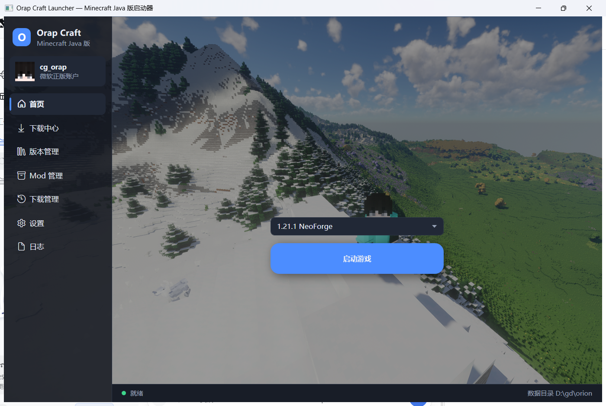 | 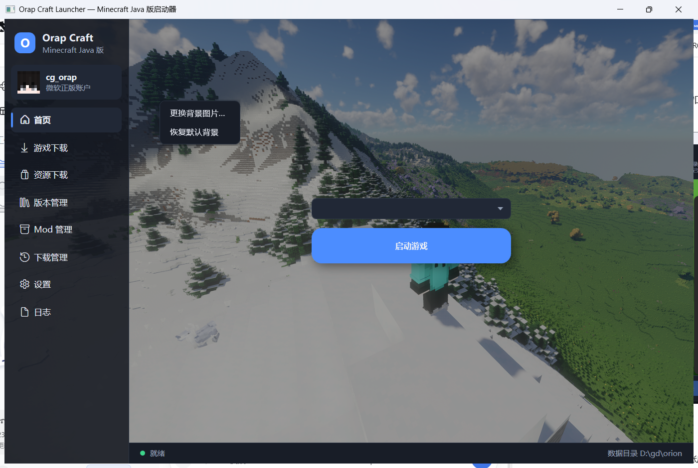 |
| --- | --- |
| 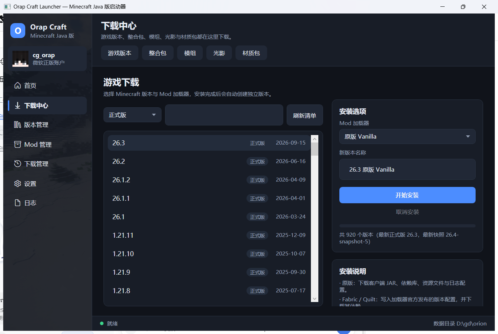 | 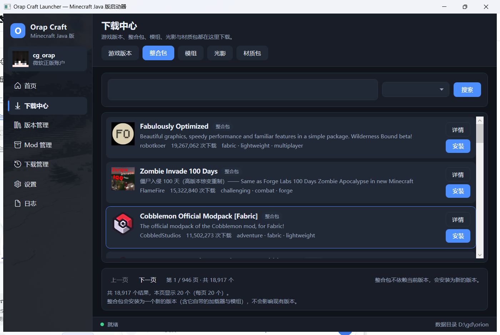 |
| 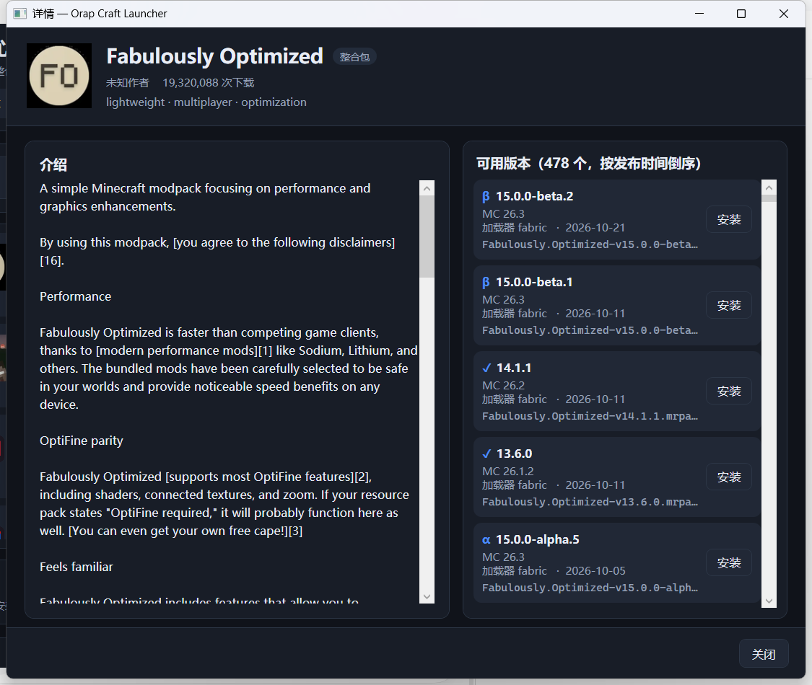 | 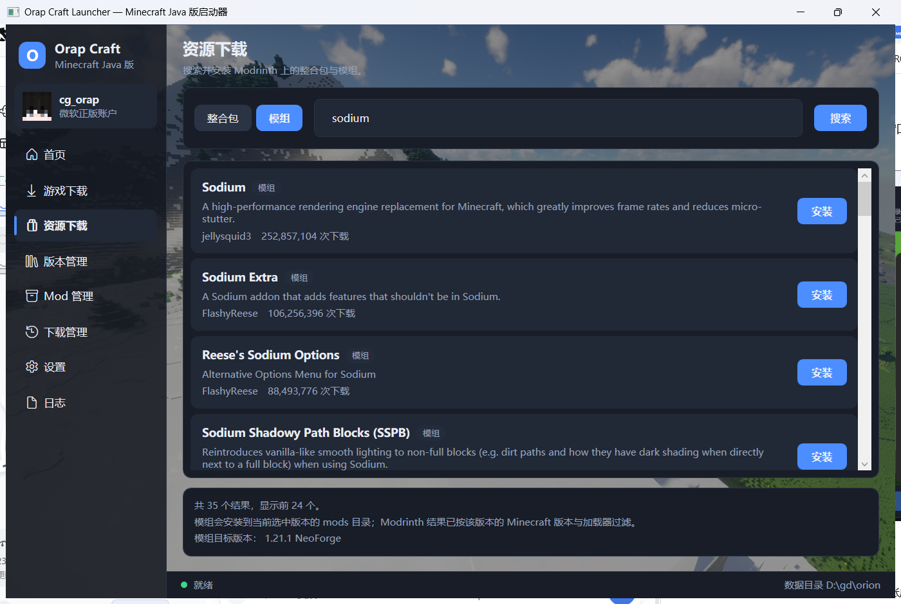 |
| 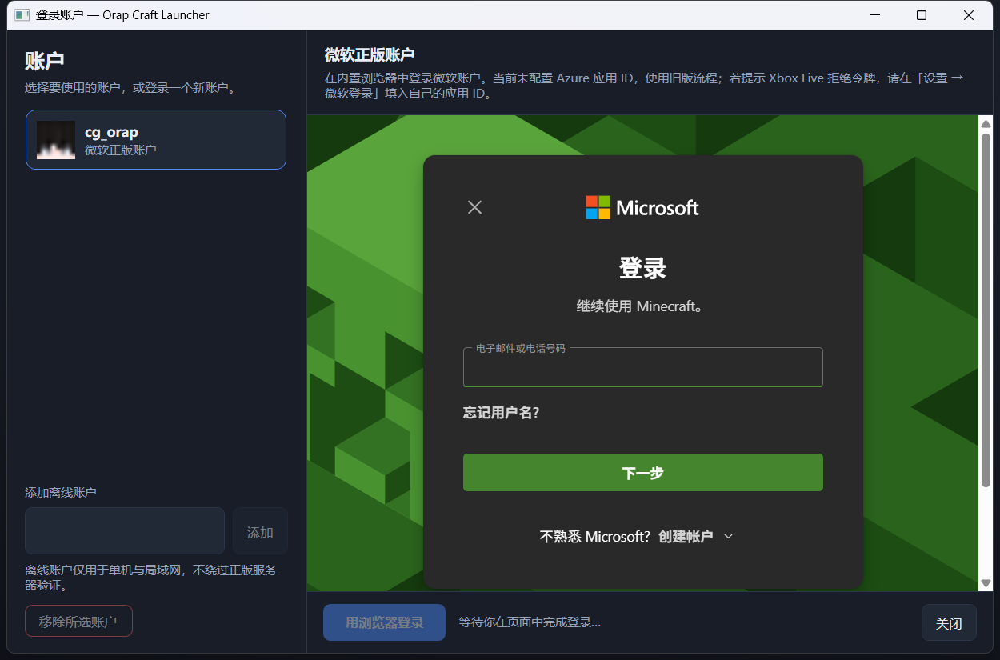 | 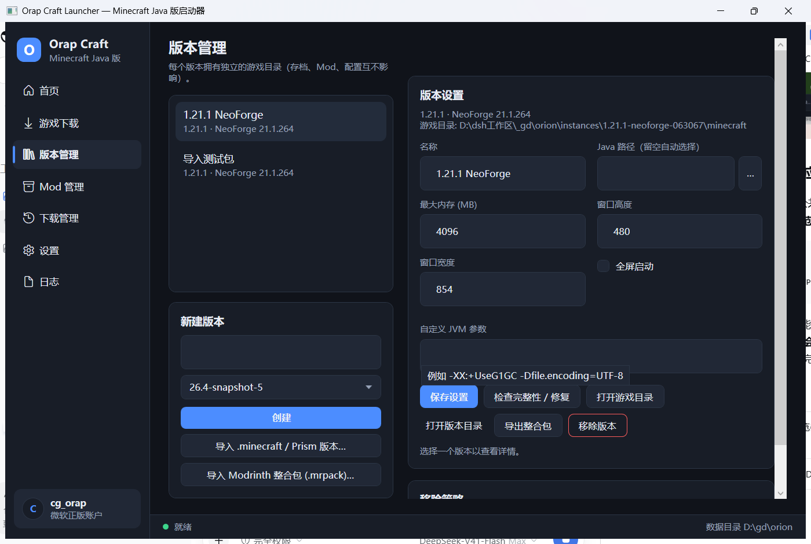 |

| 实例管理 | Mod 管理 |
| --- | --- |
|  | 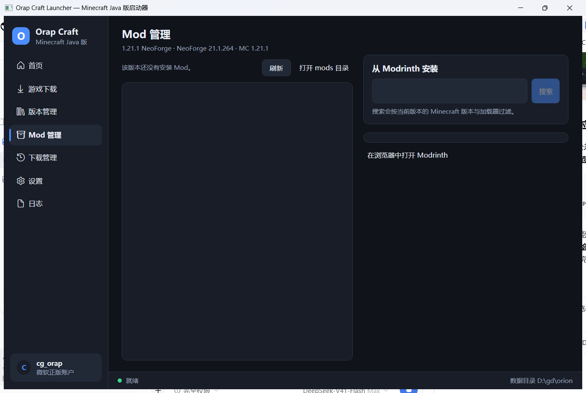 |

| 下载管理 | 设置 |
| --- | --- |
| 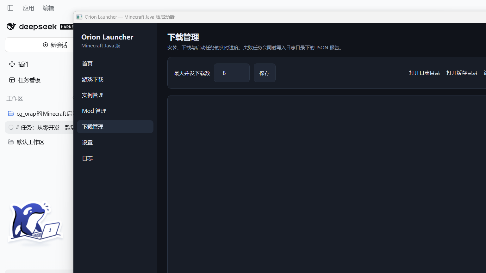 |  |

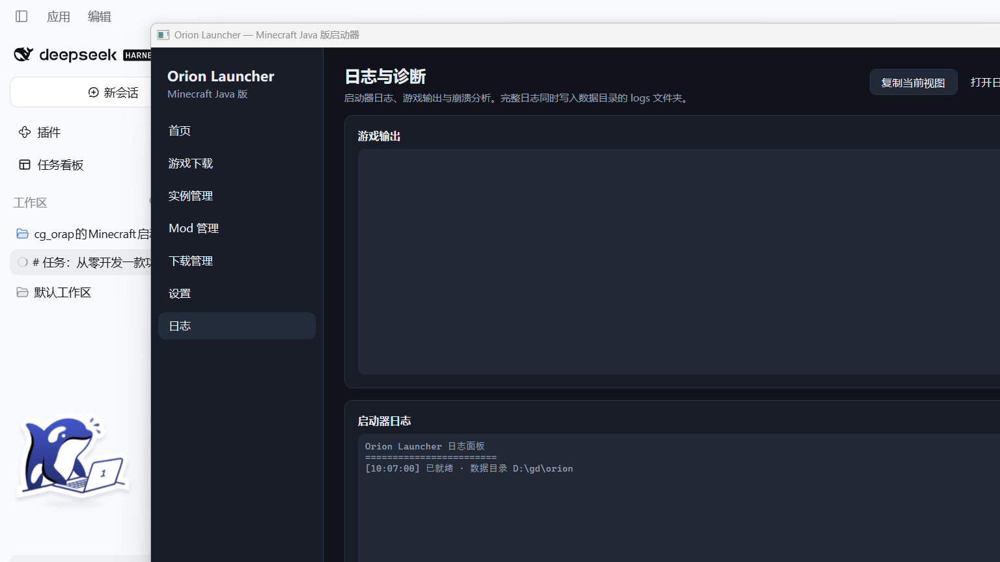

---

## 2. 快速开始

### 2.1 直接运行（推荐）

1. 解压发布包（或从 `dist/win-x64/` 取文件）。
2. 双击 `OrapCraftLauncher.exe`。
3. 首页右侧「添加离线账户」输入一个名字即可开始单人游戏；
   安装版本请到「游戏下载」页选择版本的加载器后点击「开始安装」。

数据默认保存在 `%APPDATA%\OrapCraftLauncher`（若检测到旧的 `%APPDATA%\OrionLauncher` 会继续沿用，不会丢数据）。
若希望绿色便携（数据跟着 EXE 走），在 EXE 同目录新建 `portable.txt`，数据会存到 `.\data`。

### 2.2 用命令行操作（也便于排障）

发布包内同样提供无界面命令（`orap.exe`，或在源码目录 `dotnet run --project src/Orion.Cli`）：

```text
orap help
orap java                                   # 列出检测到的 Java
orap manifest --limit 10                    # 官方版本清单
orap install 1.21.1                         # 下载安装原版
orap loaders neoforge 1.21.1                # 查看可用的 NeoForge 版本
orap install-loader neoforge 1.21.1 --mirror # 安装 NeoForge 并自动建实例
orap launch 1.21.1 --offline Steve          # 启动（缺文件会自动安装）
orap launch <实例ID> --offline Steve --memory 4096
orap verify 1.21.1 --repair                 # 完整性校验 / 修复
orap instances --create 我的世界 1.21.1
orap import "C:\Users\me\.minecraft"
orap mods <实例ID> --search sodium          # Modrinth 搜索
orap pack-import pack.mrpack                # 导入整合包
orap pack-export <实例ID> out.mrpack        # 导出整合包
```

### 2.3 从源码构建

需要 .NET SDK 10。构建脚本会自动还原、编译、跑测试并发布单文件 EXE：

```powershell
# 在仓库根目录
powershell -ExecutionPolicy Bypass -File build\build.ps1
```

产物：
- `dist/win-x64/OrapCraftLauncher.exe` — 自包含单文件 GUI（约 59 MB）
- `dist/win-x64/cli/orap.exe` — 自包含单文件命令行

常用参数：

```powershell
build\build.ps1 -SkipTests          # 跳过测试
build\build.ps1 -Configuration Debug
build\build.ps1 -DotnetRoot D:\dotnet   # 未安装到 PATH 时指定 SDK 位置
```

---

## 3. 目录结构

```text
src/Orion.Core/     启动核心（无 UI 依赖，可单独复用）
  Game/             版本元数据、继承合并、规则求值、类路径/本地库规划
  Net/              下载引擎、镜像与容灾、速率统计
  Install/          版本安装器、完整性校验/修复
  Loaders/          NeoForge / Forge / Fabric / Quilt 安装器
  Auth/             微软 OAuth→Xbox→XSTS→Minecraft，DPAPI 加密账户存储
  Launch/           启动参数生成、进程托管、日志格式化、崩溃分析
  Instances/        实例模型、目录隔离、导入
  Mods/             Mod 扫描、Modrinth、.mrpack 导入导出
  Java/             Java 检测与版本匹配
src/Orion.App/      WPF 桌面界面（MVVM，7 个页面）
src/Orion.Cli/      无界面命令行
tests/Orion.Tests/  138 项自动化测试
docs/               架构、许可证审计、测试报告、路线图
build/              构建与验证脚本
```

数据目录（默认 `%APPDATA%\OrapCraftLauncher`）：

```text
assets/       共享资源（objects/ indexes/ log_configs/）
libraries/    共享依赖库
versions/     版本元数据与客户端 JAR
instances/<id>/
  instance.json
  minecraft/  该实例独立存档、Mod、配置
cache/        清单与安装器缓存
logs/         启动器日志、下载失败报告
trash/        被移除实例/Mod 的回收站（不永久删除）
accounts.json 账户（令牌经 Windows DPAPI 加密）
settings.json 设置
```

---

## 4. 设计取舍（摘要）

- **WPF 而非 Avalonia**：目标只有 Windows，WPF 随 .NET 提供、零第三方 UI 依赖，
  自包含单文件发布链路最短。理由与备选方案对比见 [docs/ARCHITECTURE.md](docs/ARCHITECTURE.md)。
- **不依赖第三方 Minecraft 启动库**：现有成熟库多为 GPL（HMCL、Prism）或非自由许可（PCL），
  为避免许可证传染与「简单包装器」，核心完全按公开协议实现。
- **镜像只做传输替代**：所有文件仍按元数据中的 SHA-1 校验；不关闭 TLS 验证；
  镜像失败自动回退官方源。
- **删除永不直接抹掉数据**：实例与 Mod 的移除都会移动到 `trash/`。

---

## 5. 已知限制

1. **微软正版登录未与真实账户联调**（本环境无可用账户，且不便创建），
   代码按官方 OAuth → XBL → XSTS → Minecraft 流程实现，并支持令牌刷新。
   详见测试报告的「未验证项」。
2. **Forge / Fabric / Quilt 只做了实现与元数据验证**，端到端安装+启动只在
   **NeoForge 1.21.1** 上完整跑通。
3. **CurseForge** 需要官方 API Key，未接入（不做未授权抓取）。
4. 极端高 DPI + 小屏（如 1536×864 @125%）下默认窗口曾超出屏幕，已改为默认最大化；
   仍建议在 1920×1080 及以上使用。
5. 未实现 Mojang 官方 Java 运行时自动下载（目前依赖系统已安装的 Java）。
6. 未实现存档云端备份 / 多账户同时在线等增值功能。

---

## 6. 后续路线

见 [docs/ROADMAP.md](docs/ROADMAP.md)。

## 7. 致谢与参考

协议与格式依据 Mojang/Microsoft 公开接口，以及下列项目的**公开行为**（未复制其源码）：
PCL2、HMCL、Prism Launcher、XMCL、BMCLAPI。许可证审计结论见
[docs/RESEARCH-LICENSES.md](docs/RESEARCH-LICENSES.md)。
