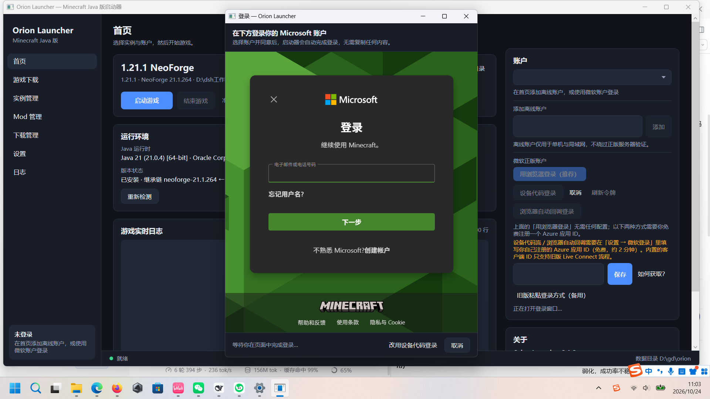

# 微软正版登录

本启动器提供 **4 种**微软登录方式。**推荐第一种**：在启动器内嵌的浏览器里选择账户并同意，
登录自动完成 —— 与 HMCL / PCL 等主流启动器的做法一致，**不需要注册 Azure 应用，也不需要复制任何链接**。

## 方式对比

| 方式 | 需要配置 | 是否需要复制链接 | 说明 |
| --- | --- | --- | --- |
| **① 用浏览器登录（推荐）** | 无 | 否 | 启动器内嵌 WebView2 打开微软登录页；登录后跳转到回调地址时被启动器拦截，直接取出授权码完成登录 |
| ② 设备代码登录 | 自备 Azure 应用 ID | 否 | 启动器给一个短代码，你在任意浏览器（可手机）输入；启动器轮询完成。适合内嵌浏览器不可用的环境 |
| ③ 浏览器自动回调登录 | 自备 Azure 应用 ID + `http://localhost` 回调 | 否 | 打开系统浏览器，登录后回调到启动器本地监听端口 |
| ④ 旧版粘贴登录（备用） | 无 | 是 | 老式 `login.live.com` 流程；授权码只有几分钟有效期，成功率不稳定，仅作兜底 |

## ① 用浏览器登录（默认，无需配置）

1. 首页「微软正版账户」→ 点击 **「用浏览器登录（推荐）」**。
2. 在弹出的窗口里选择/输入你的 Microsoft 账户并同意授权。
3. 登录成功后窗口自动关闭，启动器接着完成 Xbox Live → Minecraft 令牌交换并显示账户名。

原理：启动器内嵌 **Microsoft Edge WebView2**（Windows 11 自带运行时），导航到
`login.live.com` 的授权页；当页面跳转到 `https://login.live.com/oauth20_desktop.srf?code=…`
时，`NavigationStarting` 事件会取消这次跳转并取出 `code`，随后用内置的公共客户端 ID 换取令牌。
因此**不需要你自己注册任何应用**。

- 内嵌浏览器的 Cookie 保存在 `<数据目录>/cache/webview2`，登录一次后通常可保持会话；
  删除该目录即可彻底退出登录。
- 若系统缺少 WebView2 运行时，窗口会给出提示，并可直接改用「设备代码登录」。

## ②③ 设备代码流 / 回环回调（需要自备 Azure 应用 ID）

这两条走 `login.microsoftonline.com` 的 v2.0 端点，需要你在 Azure 免费注册一个
**公共客户端**应用（约 2 分钟），因为内置 ID 只支持旧版流程，而本项目不冒用他人的应用 ID。

1. 打开 <https://portal.azure.com>，用微软账户登录（个人账户即可，无需订阅）。
2. **Microsoft Entra ID → 应用注册 → 新注册**。
3. 名称随意；**受支持的账户类型**选「仅个人 Microsoft 账户」（或包含个人账户的选项）。
4. **重定向 URI**：仅用设备代码流可留空；用回环回调则选「公共客户端/本机」并填 `http://localhost`。
5. 复制 **应用程序(客户端) ID**。
6. **身份验证** → **允许公共客户端流 = 是** → 保存。
7. 回到启动器首页，把 ID 粘贴到「微软正版账户」下方的输入框 → **保存**。

## 常见错误与处理

| 现象 | 含义 | 处理 |
| --- | --- | --- |
| `invalid_grant ... code has expired` | ④ 旧版方式的授权码过期/已用 | 改用 ① 用浏览器登录 |
| 已登录但提示「Xbox Live 拒绝了该账户的令牌」 | 微软登录成功，XBL 拒绝该账户 | 按提示顺序排查：先在 <https://www.xbox.com> 用同一账户登录一次创建 Xbox 档案；检查账户地区；未成年人账户需家庭批准；新档案可能需等 1–2 分钟 |
| `AADSTS700016` | 应用 ID 不存在或目录不匹配 | 确认复制的是「应用程序(客户端) ID」，账户类型包含个人账户 |
| `AADSTS7000218` | 未允许公共客户端流 | 身份验证 → 允许公共客户端流 = 是 |
| `authorization_declined` | 你在浏览器里取消 | 重新登录 |
| `not_entitled` | 该账户没有 Minecraft: Java Edition | 需要正版账户 |
| 「未检测到 WebView2 运行时」 | 系统缺少内嵌浏览器组件 | 安装 WebView2 运行时，或改用 ② 设备代码登录 |

## 技术说明

- **① 内嵌浏览器**：WPF + `Microsoft.Web.WebView2`；拦截 `NavigationStarting` 中匹配
  `redirect_uri` 的导航（`MicrosoftAuthService.IsRedirectTo`），`state`/错误参数由同一套
  解析器处理；`NewWindowRequested` 一律交给系统浏览器，避免在启动器内弹窗。
- **② 设备代码流**：RFC 8628；`POST /oauth2/v2.0/devicecode` 取 `user_code`，随后按
  `grant_type=urn:ietf:params:oauth:grant-type:device_code` 轮询 `/oauth2/v2.0/token`，
  正确处理 `authorization_pending` / `slow_down` / `expired_token` / `authorization_declined`。
- **③ 回环**：本地 `TcpListener` 监听 `http://localhost:<随机端口>`，校验 `state` 防 CSRF。
- **令牌链**（三种方式共用）：Xbox Live `user.auth.xboxlive.com/user/authenticate`
  （`RpsTicket: d=<msa token>`）→ XSTS `xsts.auth.xboxlive.com/xsts/authorize`
  → `api.minecraftservices.com/authentication/login_with_xbox` → `/minecraft/profile`。
- **诊断**：XBL/XSTS 被拒时会把 HTTP 状态与响应体（截断、无凭据）写入日志与异常说明，
  并转换成可操作步骤；日志里只记录流程名与错误码，绝不记录令牌。
- **令牌存储**：内存 + Windows DPAPI 加密的 `accounts.json`；账户会记住创建它的流程，
  刷新令牌时使用同一 authority。
